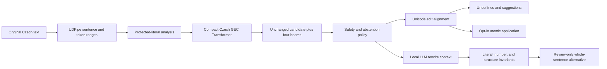

<h1 align="center">CzechCore</h1>

<p align="center"><strong>Offline, context-aware Czech grammatical error correction with exact edit spans,<br>measured on GECCC and designed for live text-editor integration.</strong></p>

<p align="center">
  <a href="https://github.com/Majkey25/CzechCore/actions/workflows/ci.yml"></a>
  <a href="https://github.com/Majkey25/CzechCore/actions/workflows/codeql.yml"></a>
  <a href="https://github.com/Majkey25/CzechCore/releases/latest"></a>
  <a href="https://www.python.org/"></a>
  <a href="#measured-status"></a>
  <a href="#privacy-and-licenses"></a>
  <a href="LICENSE"></a>
  <a href="NOTICE.md"></a>
</p>

<p align="center">
  <a href="docs/GETTING_STARTED.md">Install by device</a> ·
  <a href="docs/RESEARCH_REPORT.md">Research report</a> ·
  <a href="docs/EVALUATION.md">Evaluation</a> ·
  <a href="docs/ARCHITECTURE.md">Architecture</a> ·
  <a href="docs/API.md">API</a> ·
  <a href="docs/PLATFORM_INTEGRATION.md">Platform integration</a> ·
  <a href="docs/ROADMAP.md">Roadmap</a>
</p>

> [!IMPORTANT]
> `v0.3.2` is a research alpha, not a claim of perfect Czech or production-safe
> silent autocorrection. The proofread engine, structured edits, evaluation
> pipeline, review-only local rewrite path, Android IME, and Windows TSF source
> adapters are implemented. Native Android/Windows binaries remain unsigned and
> are therefore not distributed as production artifacts.

## What the project does

CzechCore reads a complete Czech sentence, proposes a corrected sentence, and
returns the exact source ranges needed for underlines, suggestion menus, and
explicit application. Text stays on the device after model assets are installed.

```text
Když přišel domů šel spát.  ->  Když přišel domů, šel spát.
Muži přišly domů.           ->  Muži přišli domů.
To je je vážný problém.     ->  To je vážný problém.
```

The engine is not a word-list spell checker. Its compact Czech Transformer sees
the whole sentence, while deterministic guards preserve URLs, email addresses,
paths, versions, dates, phone numbers, code-like tokens, and quotation
boundaries.

### Implemented capabilities

- contextual Czech proofread for diacritics, punctuation, agreement,
  capitalization, spacing, and other grammatical edits;
- immutable, ordered `TextEdit` objects with original Unicode offsets;
- suggestion-first output and sentence-atomic application;
- exact UDPipe sentence/token ranges and multiword-token handling;
- four-beam neural generation with the unchanged sentence as a candidate;
- batched correction for evaluation and background processing;
- hard rejection of protected-literal damage, excessive rewrites, over-length
  input, and invalid output;
- a separate local-LLM rewrite API for disordered or colloquial sentences, with
  number/literal/structure checks and mandatory human review;
- reproducible corpus, taxonomy, calibration, morphology, and local-model
  experiments with rejected results retained as evidence instead of hidden.
- Android `InputMethodService` with Czech QWERTZ input, native underlines,
  candidates, undo, privacy exclusions, and bounded automatic repairs;
- Windows x64/x86 TSF service, one local CTranslate2 broker, native settings,
  and a UAC-aware source installer payload.

### Product modes

| Mode | Current behavior | Application policy |
| --- | --- | --- |
| Proofread | Minimal sentence correction plus exact edits | Suggestions are the default |
| Experimental apply | Applies one accepted sentence atomically above a caller threshold | Opt-in; current beam score is not calibrated correctness |
| Rewrite | Uses a separately configured local LLM to reconstruct a clearer sentence | Whole sentence; always requires review |
| Live typing | Underlines, confirmation, and optional safe auto-apply | Source adapters implemented; release packaging remains gated |

Broad rewrite is intentionally separate from proofread. A fluent LLM sentence
can still alter a name, number, negation, modality, or claim.

## Measured status

The repository distinguishes a small regression suite from standard-corpus
evaluation. Headline numbers below were measured on 2026-08-18/19; they are not
marketing estimates.

| Evidence | Result | Interpretation |
| --- | ---: | --- |
| GECCC development split | 8,478 sentences | Frozen standard-corpus evaluation |
| M2 precision / recall / F0.5 | 0.7884 / 0.3551 / 0.6337 | Useful signal, substantial syntax gap |
| Correct GECCC sources changed | 558 / 3,288 | Too high for silent production use |
| Focused acceptance suite | 60 / 65 exact | 34 / 38 erroneous inputs fixed exactly |
| Acceptance false changes | 1 / 27 correct inputs | Regression evidence, not population accuracy |
| Warm acceptance latency | 72.79 ms/sentence | CPU, fixed batch 16 release run |
| GECCC mean latency | 228.72 ms/sentence | CPU, complete pipeline |
| Windows broker warm median / p95 | 159.92 / 170.96 ms | Ten end-to-end local requests |
| Windows broker working set | 306.82 MiB | FP32 model, one shared user process |
| Android emulator PSS / RSS | 365,814 / 439,824 KiB | x86_64 after inference; no phone claim |

The measured verdict is precise: the current engine already produces useful
Czech corrections and source-validated structured suggestions, but scalar beam confidence
cannot select production-grade autocorrections. At threshold `0.995`, the GECCC
development run accepts no changes; lower thresholds never reach acceptable
sentence precision. The next quality step is a trained edit-validity/
semantic-equivalence gate, not a cosmetic threshold change.

Full commands, hardware, frozen revisions, failure categories, and raw metric
definitions are in the [research report](docs/RESEARCH_REPORT.md),
[GECCC baseline](docs/research/GECCC_BASELINE.md), and
[evaluation protocol](docs/research/EVALUATION_PROTOCOL.md).

## System design



The default model is the 60.8M-parameter
[`ufal/transformer-base-geccc-mate`](https://huggingface.co/ufal/transformer-base-geccc-mate),
a BART-style Czech encoder-decoder trained with synthetic MATE errors and GECCC.
CzechCore pins the model revision, verifies the required WordPiece tokenizer,
uses the matching Czech UDPipe segmentation, and records every external artifact
in a provenance manifest.

## Scientific scope

The research layer is larger than the runtime code because Czech correction
cannot be validated by a handful of examples.

| Research artifact | Coverage |
| --- | ---: |
| Official IJP structure | 22 chapters / 202 explanations |
| Czech correction taxonomy | 13 families / 101 phenomena |
| GECCC aggregate | 83,058 sentences / 228,805 edits |
| Czech ERRANT coverage | all 65 observed error types |
| Primary-source manifest | 40 papers, datasets, repositories, model cards, and rule collections |
| Local rewrite screen | 4 model profiles, 12 meaning/invariant cases |

Mapping a phenomenon means it is named, sourced, and measurable. It does **not**
mean every phenomenon is already solved. The machine-readable taxonomy and
coverage matrix make those gaps explicit.

## Quick start

Python 3.12 is the reference release environment. Start with the complete guide
for your device:

| Device | Setup |
| --- | --- |
| Windows | [Release install, models, verification, update, uninstall](docs/setup/WINDOWS.md) |
| macOS | [Apple Silicon/Intel install and verification](docs/setup/MACOS.md) |
| Linux | [Ubuntu/general Linux install and verification](docs/setup/LINUX.md) |
| Android | [Current APK/runtime status and emulator gate](docs/setup/ANDROID.md) |

The [device chooser](docs/GETTING_STARTED.md) explains requirements, the published
wheel checksum, first-run downloads, offline verification, and supported modes.

For repository development:

```powershell
git clone https://github.com/Majkey25/CzechCore.git
cd CzechCore
py -3.12 -m venv .venv
.venv\Scripts\python -m pip install -e ".[dev]"
.venv\Scripts\czechcore download
```

`download` provisions pinned model assets explicitly. Normal correction then
runs offline and never downloads a missing model silently.

### CLI

```powershell
czechcore check "Když přišel domů šel spát."
czechcore check --json "Muži přišly domů."
czechcore check --autocorrect --min-confidence 0.995 "To je je problém."
```

### Python

```python
from czechcore import CzechCore

engine = CzechCore()
result = engine.correct("Když přišel domů šel spát.")

print(result.suggested_text)
for edit in result.edits:
    print(edit.start, edit.end, edit.replacement, edit.kind)
```

Suggestion mode leaves `result.output_text` equal to the original text. Every
edit validates that `original_text[edit.start:edit.end] == edit.source`.

### Explicit local rewrite

```python
from czechcore import CzechCore, HybridRewriter, LocalChatRewriteBackend

rewriter = HybridRewriter(
    CzechCore(),
    LocalChatRewriteBackend("http://127.0.0.1:8080/v1/chat/completions"),
)
result = rewriter.suggest(
    "jako jo je to prakticky nejpouzivanejsi nastroj na sirsi obsah nez co ma pip "
    "a hodne na ai zamereny",
    protected=("pip",),
)
```

Only loopback HTTP is accepted; redirects are refused. No screened local LLM has
yet passed the default rewrite gate, so callers must configure a model and review
every returned rewrite.

## Windows and Android direction

The deployment design keeps one correction policy and makes platform code thin:

- Android uses `SpellCheckerService` for supported editor underlines and an
  optional `InputMethodService` keyboard path for truly immediate suggestions or
  auto-apply;
- Windows uses a TSF text service for display attributes, candidates, and edits,
  with one per-user background engine so host applications do not each load a
  model;
- both adapters convert Unicode-scalar offsets to UTF-16, debounce inference,
  discard stale revisions, skip password/sensitive fields, and expose
  `off / underline / confirm / automatic` as explicit user settings;
- broad sentence rewrite remains a selection/shortcut action, never a silent
  keystroke transformation.

The complete contracts, latency budgets, trust boundaries, alternatives, and
acceptance gates are specified in
[Platform integration](docs/PLATFORM_INTEGRATION.md).

## Reproduce the repository evidence

```powershell
.venv\Scripts\python -m pytest -m "not model" --cov=czechcore --cov-report=term-missing
.venv\Scripts\python -m pytest -m model
.venv\Scripts\python -m ruff check .
.venv\Scripts\python -m ruff format --check .
.venv\Scripts\python -m pyright --pythonpath .venv\Scripts\python.exe
.venv\Scripts\czechcore-benchmark benchmarks\cases.jsonl
```

The complete GECCC run requires separately acquired licensed corpus artifacts.
Source, dataset, model, and evaluator revisions are pinned in
[`research/sources.json`](research/sources.json).

## Documentation

| Document | Purpose |
| --- | --- |
| [Install by device](docs/GETTING_STARTED.md) | Windows, macOS, Linux, and Android status/setup entry point |
| [Research report](docs/RESEARCH_REPORT.md) | Executive scientific report, results, interpretation, and release verdict |
| [Scientific basis](docs/SCIENTIFIC_BASIS.md) | Czech phenomena, model theory, and primary literature |
| [Evaluation](docs/EVALUATION.md) | Metrics, benchmark protocol, hardware, and measured baselines |
| [Architecture](docs/ARCHITECTURE.md) | Runtime flow, components, assets, and trust boundaries |
| [API](docs/API.md) | Python and CLI contracts, exact offsets, warnings, and concurrency |
| [Platform integration](docs/PLATFORM_INTEGRATION.md) | Android/Windows UX, runtime boundary, scheduling, privacy, and gates |
| [Research program](docs/research/README.md) | Taxonomy, corpora, training, calibration, and experiment index |
| [Architecture decisions](docs/decisions/README.md) | Append-only design rationale and rejected alternatives |

## Privacy and licenses

- User text is processed locally. The library performs no correction-time network
  request.
- Source code is MIT licensed.
- The default UFAL Transformer and UDPipe assets are CC BY-NC-SA 4.0 and are not
  bundled in the wheel. The current default stack is therefore non-commercial.
- The optional local rewrite model has its own license and must be reviewed
  separately.

See [NOTICE.md](NOTICE.md) for the complete asset boundary and
[SECURITY.md](SECURITY.md) for reporting and local-endpoint controls.

## Citation and contribution

Software citation metadata is in [CITATION.cff](CITATION.cff). Scientific work
should also cite the underlying GECCC and MATE publications listed in the
[research report](docs/RESEARCH_REPORT.md#references).

Contributions must preserve UTF-8 Czech, exact source offsets, offline inference,
honest benchmark failures, and strict Ruff/Pyright checks. See
[CONTRIBUTING.md](CONTRIBUTING.md).
